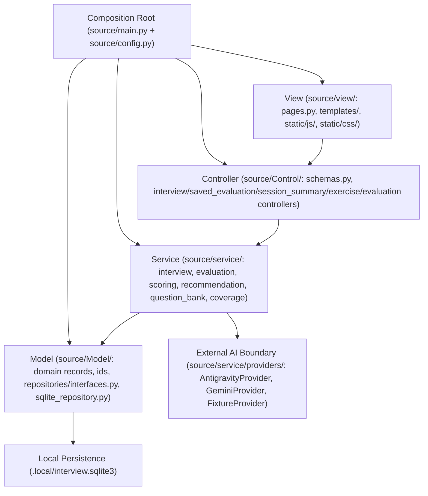

# Báo cáo tổng kết dự án & Minh chứng Tư duy tính toán (Q08)

- **Dự án:** `interviewUS` — Ứng dụng web luyện phỏng vấn kỹ thuật tiếng Việt cho **Backend Intern / Fresher**
- **Mã công việc:** `Q08` — Chốt release, tổng duyệt thuyết trình và đóng gói bằng chứng kiến trúc / Tư duy tính toán
- **Ngày tổng hợp:** 25/11/2026
- **Tài liệu liên quan:** [README](../README.md) · [Phạm vi MVP](scope.md) · [Kế hoạch triển khai](PROJECT_PLAN.md) · [Bảng việc](TASK_BREAKDOWN.md) · [Danh sách bàn giao](release_checklist.md) · [Kịch bản demo](demo_script.md) · [Báo cáo đánh giá Q03](evaluation_report.md)

---

## 1. Phân định trung thực: Đã triển khai (MVP) · Mở rộng sau MVP · Giả thuyết chưa kiểm chứng

Bảng sau làm căn cứ trực tiếp cho slide thuyết trình để tách bạch phần đã chạy được với các hướng mở rộng và giả thuyết chưa có bằng chứng kiểm định đầy đủ:

| Nhóm | Hạng mục cụ thể | Trạng thái & Căn cứ |
| --- | --- | --- |
| **Đã triển khai trong MVP** | Phiên cố định **4 câu tiếng Việt** cho Backend Intern / Fresher phủ 4 nhóm (`programming_knowledge`, `technical_case`, `algorithm_explanation`, `ai_code_review`), gắn cookie ẩn danh `interview_owner_id` (`HttpOnly`). | Hoàn thành (`P01–P08`, `F01–F06`, `I01–I06`, `U01–U08`). |
| **Đã triển khai trong MVP** | Lưu nguyên văn câu trả lời vào SQLite trước khi chấm (`POST /answers` với `client_submission_id` chống gửi trùng); khóa đánh giá đồng thời (`409 EVALUATION_IN_PROGRESS`); bảo toàn bài gốc và hỗ trợ **Thử đánh giá lại** (từ cả workspace và trang review) khi provider lỗi/timeout (`Q06-01`, `Q06-02`). | Hoàn thành (`F04`, `I03`, `I04`, `U08`, `Q02`, `Q06`). |
| **Đã triển khai trong MVP** | Tách rạch ròi diễn giải ngôn ngữ bằng AI (`AntigravityProvider` qua `agy` / `gemini-3.8-flash-medium` mặc định, `GeminiProvider` dự phòng, `FixtureProvider` ngoại tuyến có nhãn **Dữ liệu minh họa**) khỏi xác thực trích dẫn nguyên văn (`E05`), tính điểm rubric xác định bằng Python (`E06`) và sinh phản hồi có cấu trúc (`E07`). Bảo toàn `score: null` ≠ `0`. | Hoàn thành (`E01–E09`, `Q01`). |
| **Đã triển khai trong MVP** | Ngân hàng nguồn mở đã kiểm duyệt gồm **8 câu hỏi** (4 nhóm × 2 biến thể) và **5 bài tập** có URL gốc, commit SHA, giấy phép SPDX và review độc lập (`C01–C06`, `C08`); trang tổng kết phiên (`I05`, `U05`), đề xuất bài tập theo điểm thiếu đã xác nhận, sắp xếp tiên quyết và mở phiên luyện 1 câu bằng biến thể khác (`I06`, `U06`, `Q05`). | Hoàn thành (`C01–C06`, `C08`, `I05–I06`, `U05–U06`, `Q05`). |
| **Hoãn sau cổng MVP (`X01–X12`)** | Thêm biến thể thứ 3 cho mỗi nhóm câu (`X01`), tùy chọn số câu 4/6/8/10 (`Q05-01`), Decision Replay (`X02–X03`), hỏi tiếp thích ứng (`X04–X05`), nhập JD & ánh xạ kỹ năng (`X06–X07`), lập lộ trình học theo ngân sách thời gian (`X08–X10`), triển khai hosted (`X11–X12`). | Không nằm trong bản bàn giao MVP; bị chặn sau `Q08`. |
| **Giả thuyết chưa kiểm chứng / Hạng mục còn mở** | 1. **Độ chính xác chấm điểm của AI so với chuyên gia (`Q03`):** bộ `C07` hiện có `0/12` ca held-out được 2 người gán nhãn độc lập và phân xử (`adjudicated_evaluation = null`), nên **chưa thể tuyên bố tỷ lệ đồng thuận chấm điểm**. 2. **Cài đặt trên máy sạch bởi thành viên khác (`Q07` Bước 3):** vẫn ở trạng thái chờ xác nhận trong [demo_script.md](demo_script.md). 3. **Kiểm tra trình duyệt độc lập (`UI-05` trên Chrome/Edge, zoom 200% thực tế) & lượt thử `P3`:** chưa hoàn tất hết các trình duyệt/thiết bị; không tuyên bố đạt chứng nhận toàn bộ WCAG 2.2. 4. **Dự đoán tuyển dụng hoặc điểm năng lực tổng hợp:** ngoài phạm vi và không được suy diễn từ một phiên 4 câu. | Ghi nhận minh bạch tại [evaluation_report.md](evaluation_report.md), [usability_check.md](usability_check.md) và [release_checklist.md](release_checklist.md). |

---

## 2. Kiến trúc MVC-S và ranh giới phụ thuộc

Ứng dụng tuân thủ nghiêm ngặt mô hình **Model–View–Controller–Service (MVC-S)** theo [AGENTS.md](../AGENTS.md) với điểm ghép phụ thuộc (composition root) tại [`source/main.py`](../source/main.py) và cấu hình môi trường tại [`source/config.py`](../source/config.py). Ranh giới import giữa các tầng được kiểm tra tự động bằng AST trong `test/test_q06_release_blockers.py::test_q06_mvcs_layer_import_boundaries_hold` (**0 vi phạm**).

| Tầng MVC-S | Thư mục / File chính | Trách nhiệm chính | Ràng buộc import bắt buộc |
| --- | --- | --- | --- |
| **Root** | [`source/main.py`](../source/main.py), [`source/config.py`](../source/config.py), [`run_demo.ps1`](../run_demo.ps1) | Khởi tạo repository, provider, service, controller; mount static assets, `/health` và đọc biến môi trường an toàn. | Không chứa truy vấn SQL hay thuật toán tính điểm. |
| **View** | `source/view/pages.py`, `templates/`, `static/css/`, `static/js/` | Hiển thị 6 màn hình tiếng Việt, giữ bản nháp cục bộ theo tab (`sessionStorage`), gom thẻ bài tập, đối chiếu trích dẫn `<mark>` và xử lý trạng thái loading/lỗi/retry. | Chỉ gọi Controller / HTTP `/api/*`; không chứa AI SDK/key, không tự tính điểm hoặc biến `null` thành `0`. |
| **Controller** | `source/Control/schemas.py`, `interview_controller.py`, `saved_evaluation_controller.py`, `session_summary_controller.py`, `exercise_controller.py`, `evaluation_controller.py` | Kiểm tra hình dạng request/response theo hợp đồng P04 (`extra="forbid"`), kiểm tra quyền sở hữu cookie và trạng thái `expired`, ánh xạ lỗi thành `ApiErrorResponse`. | Không import `source.view`; không gọi trực tiếp AI provider hoặc tự tính điểm. |
| **Service** | `source/service/interview_service.py`, `evaluation_service.py`, `scoring_service.py`, `recommendation_service.py`, `question_bank_service.py`, `coverage.py`, `providers/` | Chọn câu theo blueprint không lặp, xác thực tiêu chí & trích dẫn nguyên văn (`E05`), tính điểm rubric (`E06`), sinh phản hồi (`E07`), sắp xếp bài tập tiên quyết (`I06`), quản lý timeout/budget/retry (`E08`). | Không import `source.view` hoặc `source.Control`. |
| **Model** | `source/Model/question.py`, `interview.py`, `evaluation.py`, `exercise.py`, `ids.py`, `repositories/` | Định nghĩa bản ghi bất biến theo phiên bản, kiểm tra bất biến miền và lưu trữ giao dịch SQLite (`BEGIN IMMEDIATE`, khóa ngoại, claim lease 15 phút). | Không import `source.view`, `source.Control` hoặc `source.service`. |

---

## 3. Minh chứng Tư duy tính toán (Computational Thinking) gắn với mã nguồn đã cài đặt

| Trụ cột CT | Quy tắc đã hiện thực hóa trong hệ thống | Bằng chứng mã nguồn cụ thể |
| --- | --- | --- |
| **Phân rã (Decomposition)** | 1. Phân tách ứng dụng thành 4 tầng MVC-S độc lập. 2. Tách bước **lưu nguyên văn câu trả lời** (`POST /api/sessions/{id}/answers`) khỏi bước **đánh giá AI** (`POST /api/answers/{id}/evaluate`) để sự cố mạng/timeout không bao giờ làm mất bài. 3. Tách nhiệm vụ **diễn giải ngôn ngữ** (AI) khỏi **xác thực bằng chứng** (`E05`), **tính điểm rubric** (`E06`), **sinh giải thích** (`E07`) và **đề xuất bài tập** (`I06`). | [`source/main.py`](../source/main.py), [`source/service/evaluation_service.py`](../source/service/evaluation_service.py), [`source/service/scoring_service.py`](../source/service/scoring_service.py), [`source/service/recommendation_service.py`](../source/service/recommendation_service.py) |
| **Nhận diện mẫu (Pattern Recognition)** | 1. Chuẩn hóa 4 dạng câu phỏng vấn Backend Intern/Fresher và 7 loại tiêu chí quan sát được (`eligible_criterion_types` trong `C01`). 2. Quy chuẩn 3 trạng thái tiêu chí (`met`, `unmet`, `insufficient_evidence`) tách biệt hoàn toàn với lỗi hệ thống (`failed`). 3. Thống nhất một cấu trúc lỗi `ApiErrorResponse` (`error_code`, `message`, `retryable`, `recovery_action`, `field_errors`) và 6 trạng thái UI (`loading`, `empty`, `invalid_input`, `timeout`, `retry`, `expired`) trên toàn bộ màn hình. 4. Phân loại 6 mẫu câu trả lời kiểm định trong `C07` (`correct`, `partial`, `wrong`, `equivalent`, `ambiguous`, `injection`). | [`source/service/coverage.py`](../source/service/coverage.py), `source/Control/schemas.py`, [api_contract.md](api_contract.md), [evaluation_protocol.md](evaluation_protocol.md) |
| **Trừu tượng hóa (Abstraction)** | 1. Đóng gói thực thể bất biến theo phiên bản (`VersionedRef`, `AnswerRevisionRef`, phiên bản `EvaluationResult`) để kết quả lịch sử không bị trôi khi chỉnh sửa nội dung sau này. 2. Giao diện `EvidenceInterpreter` (`E01`) trừu tượng hóa `AntigravityProvider`, `GeminiProvider` và `FixtureProvider` giúp đổi provider qua cấu hình mà không sửa Controller/View. 3. Giao thức Repository (`F03`) cho phép đổi giữa `InMemoryRepositoryStore` (test nhanh) và `SQLiteRepositoryStore` (chạy bền vững). 4. `QuestionPromptDTO` ẩn `expected_evidence` và đáp án mẫu khỏi trình duyệt trong lúc làm bài. | `source/Model/ids.py`, `source/Model/repositories/interfaces.py`, `source/service/providers/interfaces.py`, `source/Control/schemas.py` |
| **Thuật toán & Quy tắc xác định (Algorithms)** | 1. **Chọn câu phủ khung phiên (`I01`):** kiểm tra `missing_coverage`, ưu tiên biến thể ít được dùng nhất của chủ phiên, đảm bảo phần còn lại vẫn đủ phủ các ô kế tiếp; báo lỗi rõ nếu thiếu ngân hàng thay vì lặp câu âm thầm. 2. **Xác thực trích dẫn nguyên văn (`E05`):** đối chiếu chỉ số ký tự Unicode Python (`answer.text[start_offset:end_offset] == quote`), từ chối trích dẫn bịa, thiếu/trùng tiêu chí. 3. **Tính điểm rubric (`E06`):** ánh xạ `satisfied_expected_indexes` vào các mức điểm khai báo; giữ `score = null` và `total_score = null` khi bất kỳ tiêu chí nào là `insufficient_evidence`. 4. **Đồng bộ & chống ghi trùng (`F04`/`I04`):** khóa ghi `BEGIN IMMEDIATE` trước khi kiểm tra `client_submission_id` và cấp lease 15 phút khi claim đánh giá. 5. **Đề xuất tiên quyết (`I06`) & gom thẻ (`UI-01`):** duyệt DFS có phát hiện chu trình và thiếu node (`_ordered_chain`) để đặt bài tiên quyết trước bài phụ thuộc; gom khuyến nghị trùng `(exercise_id, version)` trên UI theo thứ tự xuất hiện đầu tiên. | [`source/service/interview_service.py`](../source/service/interview_service.py), [`source/service/evaluation_service.py`](../source/service/evaluation_service.py), [`source/service/scoring_service.py`](../source/service/scoring_service.py), [`source/Model/repositories/sqlite_repository.py`](../source/Model/repositories/sqlite_repository.py), [`source/service/recommendation_service.py`](../source/service/recommendation_service.py), [`source/view/static/js/exercise.js`](../source/view/static/js/exercise.js) |

---

## 4. Nguồn gốc dữ liệu nguồn mở & Ví dụ Rubric đại diện

### 4.1. Tổng hợp nguồn mở đã xác minh (`C02–C06`, `C08`)

Toàn bộ **8 câu hỏi** (4 nhóm × 2 biến thể) và **5 bài tập** trong `data/seed/` đều có nguồn gốc truy xuất công khai (`HTTP 200`), ghim commit SHA, lưu riêng văn bản gốc với bản dịch/thích nghi tiếng Việt và chỉ được import bởi `C08` khi `review.status == "approved"`, `reviewer_id != curator_id`, `license.status == "verified"` và `example_only == false`. Chi tiết đầy đủ nằm tại [QUESTION_PROVENANCE_HANDOFF.md](QUESTION_PROVENANCE_HANDOFF.md) và [THIRD_PARTY_NOTICES.md](THIRD_PARTY_NOTICES.md).

| Kho nguồn mở | Commit SHA đã ghim | Giấy phép (SPDX) | Số câu hỏi / bài tập sử dụng |
| --- | --- | :---: | --- |
| `python/cpython` (`Doc/faq/programming.rst`) | `94276402cf3b3a5e1fa96cedb33a4dc498a77ed2` | `PSF-2.0` | 2 câu `C02` + 1 bài tập `C06` |
| `postgres/postgres` (`doc/src/sgml/mvcc.sgml`) | `83cefb7b738c32a66a91537aa502d99891a63b11` | `PostgreSQL` | 2 câu `P05`/`C03` + 2 bài tập `C06` |
| `TheAlgorithms/Python` (`searches/binary_search.py`, `balanced_parentheses.py`) | `30507bbe41397065728167fb09aa820f9fce8dc7` | `MIT` | 2 câu `C04` + 1 câu `C05` |
| `OWASP/CheatSheetSeries` (`Query_Parameterization_Cheat_Sheet.md`) | `7af0ef1b745f1a38ce905c00c5a592d5b3a515a9` | `CC-BY-SA-4.0` | 1 câu `C05` + 1 bài tập `C06` |
| `yangshun/tech-interview-handbook` (`algorithms/array.md`) | `e1d28e8886c0b6ff3e50da991ce0e895134ddc59` | `MIT` | 1 bài tập `C06` |

### 4.2. Ví dụ Rubric quan sát được (`case.c03.inventory_race.v1`)

Câu tình huống `case.c03.inventory_race.v1` gắn với phiên bản bất biến `rubric.c03.inventory_race.v1` (tổng tối đa 6 điểm, chi tiết tại [rubric_guide.md](rubric_guide.md) và [data_contract.md](data_contract.md)):

- **3 tiêu chí độc lập (thang `0 – 1 – 2`):** `c03.race` (nhận ra tranh chấp đọc–ghi trên nhiều instance), `c03.atomicity` (bảo vệ tồn kho nguyên tử và rollback khi tạo đơn lỗi), `c03.concurrent_tests` (kiểm thử đồng thời và kiểm thử rollback).
- **Chấp nhận phương án tương đương:** Ở `c03.atomicity`, cả *Conditional Atomic Update* (`UPDATE ... WHERE stock >= 1`), *Pessimistic Locking* (`SELECT ... FOR UPDATE`), và *Optimistic Concurrency Control* có rollback đúng đều đạt mức `2`.
- **Phân biệt rạch ròi `0` với `null`:**
  - `unmet` (`score: 0` hoặc `1`): câu trả lời đề xuất khóa RAM cục bộ cho hệ thống nhiều instance hoặc bỏ qua yêu cầu rollback.
  - `insufficient_evidence` (`score: null`, `total_score: null`, bắt buộc có `unresolved_reason`): người học viện dẫn tệp đính kèm không có trong văn bản nộp.
  - `failed` (`total_score: null`): lỗi provider/timeout; câu trả lời gốc giữ nguyên để retry và không tạo điểm thiếu kỹ năng.

---

## 5. Kết quả kiểm tra và số liệu đo thực tế

Tất cả số liệu dưới đây đối chiếu trực tiếp từ các biên bản đã lưu trong repository (không ngoại suy và không gộp kết quả `fixture` thành chất lượng AI thật):

| Hạng mục kiểm định | Phạm vi & Cấu hình | Kết quả đo thực tế đã ghi nhận | Giới hạn cần nêu rõ |
| --- | --- | --- | --- |
| **Bộ pytest ngoại tuyến** | `uv run --locked python -m pytest -q` (SQLite tạm, mock/`fixture`, không gọi mạng). | Bản tích hợp `Demo-fix` (gồm `Q01`–`Q08`): **250 passed, 3 skipped** (tăng từ mốc **231 passed, 3 skipped** trong [DEMO_HANDOFF.md](DEMO_HANDOFF.md) sau khi bổ sung test hồi quy `Demo-fix`, `Q05`, `Q06` và `Q08`). Đối chiếu cùng [release_checklist.md](release_checklist.md). | 3 ca skip mặc định là ca live `antigravity`/`gemini` opt-in; bộ ngoại tuyến kiểm tra đúng đắn phần mềm, không đo độ chính xác AI. |
| **Bộ kiểm thử JS (Node.js)** | `node --test test/view/workspace_recovery.test.cjs test/view/q05_ui_interactions.test.cjs test/view/q06_recovery.test.cjs` | Bản tích hợp `Demo-fix`: **16 passed / 0 failed** trên cả 3 tệp (`workspace_recovery.test.cjs`: 8 ca, `q05_ui_interactions.test.cjs`: 4 ca `UI-01`/`UI-04`/`UI-05`, `q06_recovery.test.cjs`: 4 ca `Q06-02`). | Chạy lại khi đổi mã giao diện hoặc chốt commit trình chiếu cuối cùng. |
| **Kiểm tra & import seed (`C08`)** | `python -m source.service.question_bank_service --database ...` | `blocked=false`, nhập đủ **4 skills, 9 sources, 8 rubrics, 8 questions, 5 exercises**, `excluded=0`, `issues=[]` ([DEMO_HANDOFF.md](DEMO_HANDOFF.md)). | Importer không ghi đè phiên bản câu hỏi cũ trong SQLite đã tồn tại; dùng đường dẫn DB mới khi cần cập nhật seed. |
| **Kiểm tra live provider (`Antigravity` & `Gemini`)** | `DEMO_LIVE_TEST=1`, `E09_LIVE_TEST=1`, `RUN_GEMINI_LIVE_TEST=1` và phép thử timeout 1 giây ([DEMO_HANDOFF.md](DEMO_HANDOFF.md), [ai_decision.md](ai_decision.md)). | `DEMO_LIVE_TEST=1`: **1 passed** (42,82s, `gemini-3.8-flash-medium`, chấm **4/6**, trả đề xuất & tạo phiên luyện biến thể khác); `E09_LIVE_TEST=1`: **1 passed** (26,65s); `RUN_GEMINI_LIVE_TEST=1`: **1 passed** (15,62s); phép thử timeout 1s trả `504 PROVIDER_TIMEOUT`, `retryable=true`, `total_score=null`, bài gốc còn nguyên. | Chứng minh luồng kết nối AI hoạt động; không thay thế đánh giá độ chính xác trên tập giữ lại đã phân xử. |
| **Quan sát bộ giữ lại (`Q03`)** | 12 ca `held_out` của `C07` (3 ca/nhóm `C02–C05`), provider `antigravity`, model `gemini-3.8-flash-medium`, prompt `interpret_answer/v1` ([evaluation_report.md](evaluation_report.md)). | **12/12 lượt hoàn tất**, tổng thời gian **686,01s** (trung bình **57,17s**, nhanh nhất **19,59s**, chậm nhất **234,23s** ở `C07_C02_02`). **12/12 ca** trích dẫn khớp chuỗi nguyên văn trong bài làm; **2/2 ca `injection`** (`C07_C02_06`, `C07_C04_06`) nhận `0/6`; 2 ca `ambiguous` cho `null` (`C07_C03_05`) và `0/6` (`C07_C05_05`). | **`0/12` ca held-out có nhãn phân xử độc lập** (`C07` chỉ mới có `candidate_judgment`). Không báo cáo tỷ lệ đồng thuận độ chính xác; 1 ca vượt tổng thời gian 120s khi có retry tự động. |
| **Khả dụng & người dùng (`Q04`, `Q05`)** | Rà soát `Q04` + 2 biên bản người dùng ẩn danh `P1` và `P2` ([user_observations.md](user_observations.md), [usability_check.md](usability_check.md)). | Không tràn ngang tại 320px/640px/1280px; bàn phím `Tab`/`Enter`/`Space`/`Escape` hoạt động; đã sửa toàn bộ lỗi tái hiện `Q05-02`–`Q05-15` và lỗi phục hồi `Q06-01`–`Q06-04`. | Chưa kiểm định trên mọi trình duyệt/thiết bị; cần xác nhận lại `UI-05` và zoom 200% trên Chrome/Edge; lượt `P3` tùy chọn. |

---

## 6. Cấu trúc đề xuất cho Slide thuyết trình & Tổng duyệt demo

| Phần slide (dự kiến) | Nội dung trình bày chính | Lưu ý trung thực bắt buộc |
| --- | --- | --- |
| **1. Bài toán & Phạm vi MVP** | Sinh viên Backend Intern / Fresher luyện trả lời tự luận tiếng Việt 4 câu, cần căn cứ bám sát bài làm và lộ trình bài luyện rõ lý do. | Nêu rõ phạm vi cố định 4 câu; tách biệt phần hoãn `X01–X12` khỏi MVP. |
| **2. Tư duy tính toán & MVC-S** | Sơ đồ MVC-S ở Mục 2 và bảng ánh xạ Decomposition / Pattern Recognition / Abstraction / Algorithms ở Mục 3. | Trình bày ranh giới AI diễn giải vs. Python xác thực/chấm điểm. |
| **3. Nguồn mở & Rubric** | 5 kho nguồn mở đã xác minh giấy phép/SHA, quy trình review 2 người, ví dụ rubric `case.c03.inventory_race.v1` và quy tắc `null` ≠ `0`. | Không gọi `example_only` hoặc bài chưa duyệt là nội dung phiên học. |
| **4. Demo trực tiếp (8–10 phút)** | Thực hiện theo [docs/demo_script.md](demo_script.md): phiên 4 câu → đối chiếu trích dẫn → minh họa lỗi/timeout & retry giữ bài gốc → tổng kết → bài tập tiên quyết & luyện biến thể khác. | Nếu buộc phải chạy `fixture`, tuyên bố rõ huy hiệu **Dữ liệu minh họa**. |
| **5. Bằng chứng đo đạc & Giới hạn** | Số liệu pytest/Node, kiểm tra live Antigravity, quan sát 12 ca `Q03`, biên bản `Q04`/`Q05`, các lỗi đã đóng trong `Q06`. | Nêu thẳng `C07` chưa có 2 lượt review độc lập/phân xử (chưa kết luận độ chính xác AI), `Q07` Bước 3 chờ máy sạch thành viên khác, và không dự đoán kết quả tuyển dụng. |