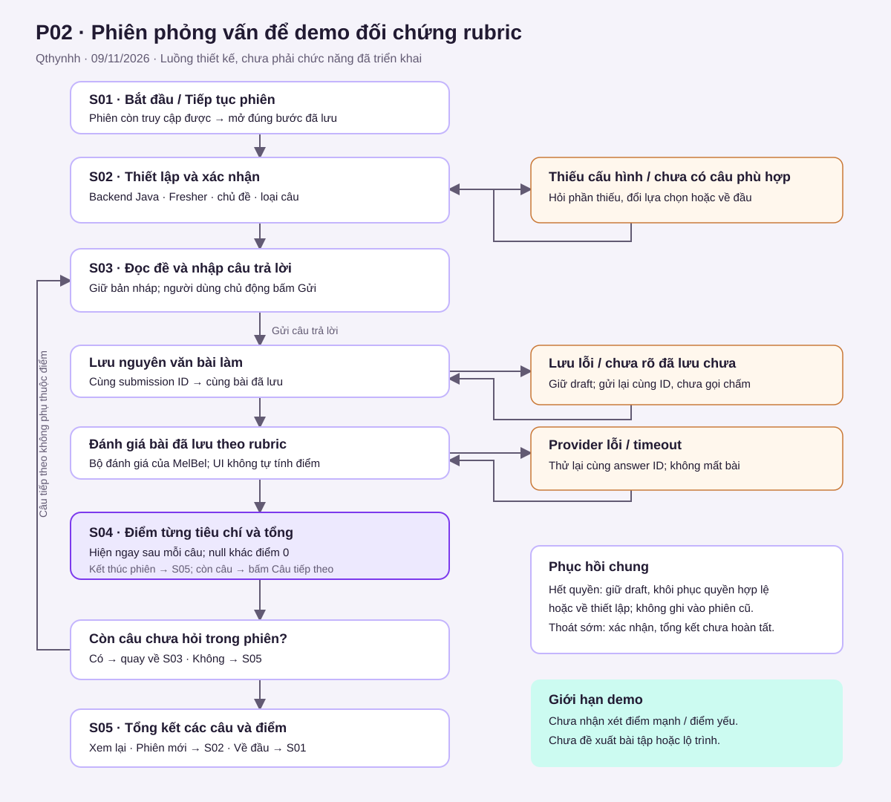
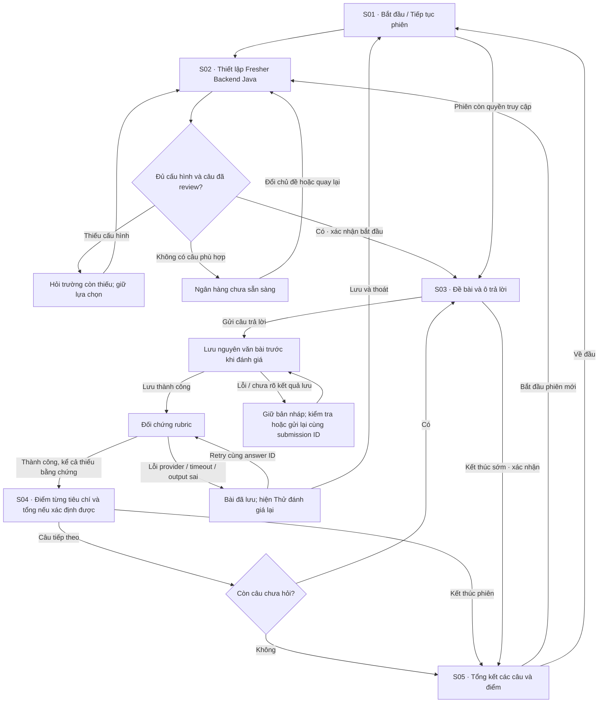
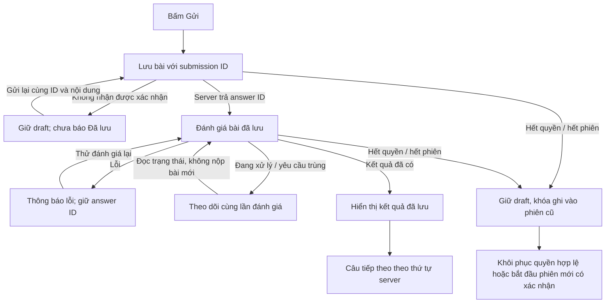

# P02 — Luồng phỏng vấn và phục hồi lỗi

| Thuộc tính | Nội dung |
| --- | --- |
| Người thực hiện | Qthynhh |
| Ngày | 09/11/2026 |
| Trạng thái tài liệu | Đề xuất để review; chưa phải chức năng đã triển khai |
| Phụ thuộc | P01; tham chiếu model/version ở P03 |
| Đầu ra | Luồng chính, nhánh lỗi, dữ liệu từng màn hình và bàn giao API/UI |

## 1. Phạm vi theo yêu cầu demo hiện tại

Người học luyện phỏng vấn **Fresher Backend Java**, trả lời văn bản cho từng câu
lý thuyết hoặc case study. Sau mỗi lần gửi, hệ thống đối chứng bài với rubric và
hiện **điểm từng tiêu chí, tổng điểm của câu đó**. Người học bấm “Câu tiếp theo”
để tiếp tục; chọn câu không dựa trên điểm.

Đây là lát cắt demo người dùng đã xác nhận trong chat. `scope.md`,
`PROJECT_PLAN.md`, `TASK_BREAKDOWN.md` và `TASK_INSTRUCTIONS.md` được giữ nguyên.
Chúng mô tả phạm vi rộng hơn: bốn nhóm câu, phân tích điểm thiếu và bài tập.
P02 này không tự sửa hoặc tuyên bố hoàn thành các phần đó.

| Nội dung | Quyết định cho demo |
| --- | --- |
| Mỗi lượt | Một câu, gửi xong xem điểm ngay |
| Đầu ra | Điểm từng tiêu chí và tổng của câu; giữ bài đã gửi để xem lại |
| Câu tiếp theo | Lấy trong tập câu đã review; tránh lặp trong cùng phiên, không thích ứng theo điểm |
| Tổng kết | Danh sách các câu đã làm và điểm tương ứng; không suy ra năng lực tổng thể |
| Nhận xét điểm mạnh/yếu | Chưa làm |
| Đề xuất bài tập/lộ trình/câu theo năng lực | Chưa làm; không có CTA dẫn tới trang chưa hoạt động |
| Công thức, thang điểm, trọng số | MelBel chốt; UI chỉ hiển thị kết quả, không tự cộng hoặc chuẩn hóa |
| Lưu trữ | SQLite theo hướng đã có trong kế hoạch; hành vi lưu bên dưới là yêu cầu cho F04/I03, chưa được code |
| Số câu | Hiển thị số câu thực tế server chuẩn bị; giới hạn và giá trị mặc định chốt ở P04/C01 |

## 2. Sơ đồ luồng chính

Mermaid dưới đây là bản có thể sửa và review trực tiếp trên GitHub. SVG là bản
tổng quan cùng luồng để xem nhanh/chèn slide.

Sau lỗi ở S03/S04, người dùng luôn có đường retry, tiếp tục sửa bản nháp hoặc
quay về đầu sau khi đã bảo toàn bài. “Lưu và thoát” chỉ báo thành công khi server
xác nhận lưu; không đóng màn hình nếu lưu thất bại mà người dùng chưa chọn bỏ bản nháp.

## 3. Màn hình, dữ liệu và API dự kiến

Các endpoint là đề xuất bàn giao **P04**, không phải API đã tồn tại. Các mã S01–S05
trong tài liệu là bước luồng; không phải mã task F01/I01 trên sprint.

| Bước | Dữ liệu vào / hiển thị | Hành động chính và bước tiếp | API dự kiến |
| --- | --- | --- | --- |
| S01 · Bắt đầu | Phạm vi demo; phiên đang làm nếu có; empty/loading/error | Bắt đầu → S02; Tiếp tục → đúng câu/trạng thái đã lưu | Đọc phiên từ ID đã lưu trong cùng browser session: `GET /api/sessions/{id}`; cách tìm ID chốt P04 |
| S02 · Thiết lập | Role Java Backend, cấp Fresher, chủ đề/loại câu đủ điều kiện, tóm tắt cấu hình | Sửa lựa chọn; làm rõ phần thiếu; xác nhận → S03 | `POST /api/sessions`; nguồn danh sách lựa chọn/validation chốt P04 |
| S03 · Workspace | Đề, ràng buộc, code nếu đề có, nguồn, tiến trình, ô trả lời và trạng thái lưu | Gửi → lưu → đánh giá; Lưu và thoát; kết thúc sớm có xác nhận | `POST /api/sessions/{id}/answers` rồi `POST /api/answers/{id}/evaluate`; draft/end endpoint còn chốt P04 |
| S04 · Kết quả một câu | Nguyên văn bài đã gửi; tên tiêu chí, điểm/max khi có; tổng/max khi có; lỗi xử lý tách riêng | Câu tiếp theo → S03 hoặc S05; Kết thúc → S05; Retry khi đánh giá lỗi | `GET /api/answers/{id}/evaluation`; `POST /api/sessions/{id}/next`; evaluate cho retry |
| S05 · Tổng kết | Câu đã làm và kết quả từng câu; số câu chưa làm/chưa có điểm; nhãn kết thúc sớm nếu có | Xem lại kết quả → S04 read-only; Bắt đầu phiên mới → S02; Về đầu → S01 | `GET /api/sessions/{id}/summary`; end operation chốt P04 |

S04 có thể là panel trong cùng trang S03, không bắt buộc URL riêng. Nếu xem lại
kết quả cũ, nút “Câu tiếp theo” chỉ dùng với câu hiện tại của phiên còn hoạt động;
không cho dùng lịch sử để nhảy thứ tự. Có nút quay lại S05.

**Điểm và rubric:** `0` là điểm hợp lệ. `null` hiển thị “Chưa đủ bằng chứng” hoặc
“Chưa có kết quả” tùy trạng thái. Không đổi null thành 0. Nếu MelBel chưa trả điểm
tổng có căn cứ, UI không tự suy ra tổng. Không cộng trung bình nhiều rubric thành
điểm năng lực chung. Rubric nội bộ và đáp án tham khảo không nằm trong DTO đề bài.

## 4. Nhánh phục hồi

Mũi tên theo dõi `pending` thể hiện đọc trạng thái, không gọi đánh giá mới liên tục.
Polling/timeout tối đa cần P04/E08 chốt; không tạo vòng retry vô hạn.

| Trường hợp | Thông báo / trạng thái UI | Cách phục hồi và dữ liệu giữ lại |
| --- | --- | --- |
| Đang tải câu/phiên | “Đang tải…”; không hiện đề/điểm giả | Thành công thì mở bước thật; lỗi có Thử tải lại và Về đầu |
| Bank rỗng / hết câu phù hợp | “Chưa có câu hỏi phù hợp” | Sửa bộ lọc hoặc về S01; chưa tạo phiên rỗng |
| Cấu hình thiếu | Chỉ rõ trường thiếu ở S02 | Giữ các lựa chọn khác, focus trường cần sửa |
| Bài rỗng / quá giới hạn | Lỗi cạnh ô trả lời, chưa gửi | Giữ nội dung; giới hạn phải lấy từ contract, không tự đặt số |
| Lưu lỗi | “Chưa lưu được câu trả lời” | Giữ draft; gửi lại. Chưa gọi evaluator |
| Mất mạng sau khi server có thể đã lưu | “Chưa xác nhận được trạng thái lưu” | Giữ submission ID và snapshot bài; gửi lại cùng ID, server trả cùng bài nếu đã có |
| Bấm gửi trùng | Nút disabled khi đang gửi | Backend idempotent; cùng ID + khác nội dung phải báo conflict, không ghi đè |
| Provider lỗi / timeout / output sai | “Bài đã lưu. Chưa đánh giá được, hãy thử lại” | Retry với answer ID, không tạo bài mới và không gán điểm 0 |
| Đánh giá đang chạy | “Đang đánh giá…” | Đọc cùng trạng thái; không tạo kết quả song song |
| Kết quả thành công nhưng thiếu bằng chứng | “Chưa đủ bằng chứng” tại mục tương ứng | Giữ null; không coi đây là lỗi provider. Cho chuyển câu theo policy dưới đây |
| Lỗi chuyển câu | Giữ panel điểm hiện tại | Thử lại cùng yêu cầu chuyển câu; server không nhảy hai câu |
| Reload / mở lại | Tách draft cục bộ khỏi bài server đã lưu | Đọc trạng thái server; mở đúng câu hoặc kết quả, không gửi tự động |
| Hết phiên/quyền truy cập | “Phiên không còn khả dụng”; không đưa ra điểm giả | Giữ draft để sao chép; quay về setup. Chỉ phục hồi qua cơ chế quyền hợp lệ, không dùng ID để vượt quyền |
| Kết thúc sớm | Hộp xác nhận và số câu chưa làm | Hủy → quay lại; xác nhận → tổng kết “Chưa hoàn tất”; câu chưa làm không thành 0 |

## 5. Đề xuất chính sách để P04/I01 triển khai

Các quy tắc sau là hành vi đề xuất trong P02, cần reviewer chốt trước khi code:

1. Khi tạo phiên, server cố định thứ tự và ID/version các câu đã review đủ điều
   kiện. Không lặp cùng logical question trong phiên khi còn lựa chọn khác.
2. Mỗi câu có một bài nộp trong lượt demo; sửa được bản nháp trước gửi. Không có
   nút sửa/chấm lại bài đã thành công trong phạm vi hiện tại.
3. Submission ID gắn snapshot nội dung và câu. Lỗi lưu không rõ kết quả thì giữ
   snapshot đó để đối soát trước khi cho sửa/nộp một bài khác.
4. `completed` của đánh giá khác điểm cao/thấp. Kết quả thiếu bằng chứng vẫn có
   thể là completed. Chỉ mở Câu tiếp theo sau completed; provider failed thì retry
   hoặc lưu/thoát, không tự bỏ qua câu và ghi điểm 0.
5. Chuyển câu do server kiểm soát. Đọc hoặc gửi lại yêu cầu trùng không được tăng
   vị trí hai lần; trường hoặc token thực hiện chốt ở P04.
6. Trong lúc đợi đánh giá, có thể lưu/thoát và mở lại; lần xử lý cũ vẫn chỉ gắn
   với đúng answer revision. Không hứa tác vụ chạy nền nếu chưa có implementation.
7. Draft ở trình duyệt chỉ là phương án phục hồi, không phải xác nhận lưu SQLite.
   P04 chốt nơi lưu draft, phạm vi browser owner và thời điểm xóa. Không khôi phục
   draft của phiên/người khác vào màn hình mới.
8. Hết câu hoặc kết thúc sớm đều đến tổng kết hữu ích. Không đặt CTA bài tập,
   điểm mạnh/yếu hay lộ trình trong demo này.

## 6. Đối chiếu thiết kế Figma

[File Purple Glass UI/UX](https://www.figma.com/design/IAFdJtqvSdDrfFHbtxZHxs?node-id=5-403)
là reference người dùng gửi. Mapping dưới lấy từ hồ sơ bàn giao cục bộ đã có,
không phải xác nhận canvas vừa được đọc. Node `5:403` chưa xác định được màn hình;
không suy đoán nó là workspace từ URL.

| Bước P02 | Frame reference trong hồ sơ cũ | Điều chỉnh cho demo |
| --- | --- | --- |
| S01 | [I01 · Hub, 5:299](https://www.figma.com/design/IAFdJtqvSdDrfFHbtxZHxs?node-id=5-299) | Một CTA bắt đầu, tiếp tục khi có phiên; không cần đưa toàn sản phẩm vào demo |
| S02 | [I03 · Setup, 5:431](https://www.figma.com/design/IAFdJtqvSdDrfFHbtxZHxs?node-id=5-431) | Xác nhận Java/Fresher/chủ đề; làm rõ đầu vào thiếu |
| S03 | [I04 · Text/case, 9:144](https://www.figma.com/design/IAFdJtqvSdDrfFHbtxZHxs?node-id=9-144) | Đề bài và một composer; chưa có chat AI/gợi ý/voice |
| S04 | [F01 · Feedback, 9:327](https://www.figma.com/design/IAFdJtqvSdDrfFHbtxZHxs?node-id=9-327) | Chỉ điểm từng tiêu chí/tổng và bài đã gửi; bỏ nhận xét điểm mạnh/yếu |
| S05 | [F02 · Summary, 9:385](https://www.figma.com/design/IAFdJtqvSdDrfFHbtxZHxs?node-id=9-385) | Liệt kê kết quả từng câu; bỏ roadmap/bài tập và kết luận năng lực |

Brief Figma cũ dành chế độ mô phỏng cho điểm cuối phiên. Demo mới **cố ý dùng
điểm ngay từng câu** theo lựa chọn mới nhất của người dùng; cần chú thích điều này
khi cập nhật prototype. Chưa sửa canvas hoặc xác nhận các prototype link hoạt động.

Brief nguồn trong workspace cha: `deliverables/figma-design-brief/02-visual-direction-and-tokens.md`,
`08-all-product-pages.md`, `09-session-and-assessment-flows.md`,
`10-screen-and-prototype-coverage.md`, `FIGMA_HANDOFF.md`. Chúng không nằm trong
checkout GitHub; các quyết định cần cho reviewer được ghi lại ở đây và
[ui_direction.md](ui_direction.md).

## 7. Walkthrough nghiệm thu tài liệu

Đã đối chiếu đường đi trên sơ đồ và ma trận bằng đọc tài liệu; chưa chạy app hoặc
kiểm thử provider/SQLite. Reviewer độc lập chưa được chỉ định, chưa xác nhận Done.

| ID | Kịch bản review | Kết quả cần tìm trong tài liệu |
| --- | --- | --- |
| W01 | Bắt đầu, xác nhận cấu hình, trả lời một câu | S01 → S02 → S03 → lưu bài → S04 |
| W02 | Còn câu / hết câu | S04 → S03 nếu còn; S04 → S05 nếu hết, không theo điểm |
| W03 | Lưu lỗi | Không gọi evaluator; giữ draft và retry |
| W04 | Provider timeout sau khi lưu | Retry đúng answer ID; bài không mất, không có điểm giả |
| W05 | Bấm gửi/chuyển câu hai lần | Cùng bài/cùng vị trí; không tạo bản ghi hoặc bước trùng |
| W06 | Hết phiên khi đang nhập | Giữ draft, giải thích lỗi, về setup không vượt quyền |
| W07 | Kết thúc sớm và mở lại kết quả | Tổng kết không hoàn tất, mở bài read-only rồi quay lại S05 |
| W08 | Bank chưa review hoặc rỗng | Không tạo phiên; có đổi cấu hình/Về đầu |

Checklist cũ yêu cầu đi tới bài tập: phần đó được **hoãn theo chỉ đạo demo hiện
tại**, thay bằng tổng kết và bắt đầu lại. Không ghi đạt toàn bộ luồng bài tập cũ.

## 8. Bàn giao

- **P04:** DTO, lỗi chuẩn, session ownership, token idempotency, draft/end/resume.
- **P06:** đối chiếu canvas, hoàn thiện wireframe/responsive và prototype theo
  [ui_direction.md](ui_direction.md); P02 không tự đánh dấu P06 xong.
- **F02–F04:** model, repository và SQLite giữ nguyên bài, version, transaction.
- **E01–E09 / MelBel:** đánh giá, điểm, trạng thái và failure codes.
- **I01–I05:** thứ tự câu, ownership, lưu bài, retry và tổng kết.
- **U01–U05/U07/U08:** UI theo các trạng thái đã mô tả; phần bài tập U06/I06 hoãn
  trong demo, không thay đổi dependency graph trên bảng bằng tài liệu này.

Tư duy tính toán: phân rã thành 5 bước; nhận diện cùng mẫu loading/empty/error;
trừu tượng hóa bản nháp/bài đã lưu/kết quả; thuật toán điều phối kiểm tra cấu hình,
lưu trước chấm, xử lý yêu cầu trùng và chuyển câu hữu hạn.
